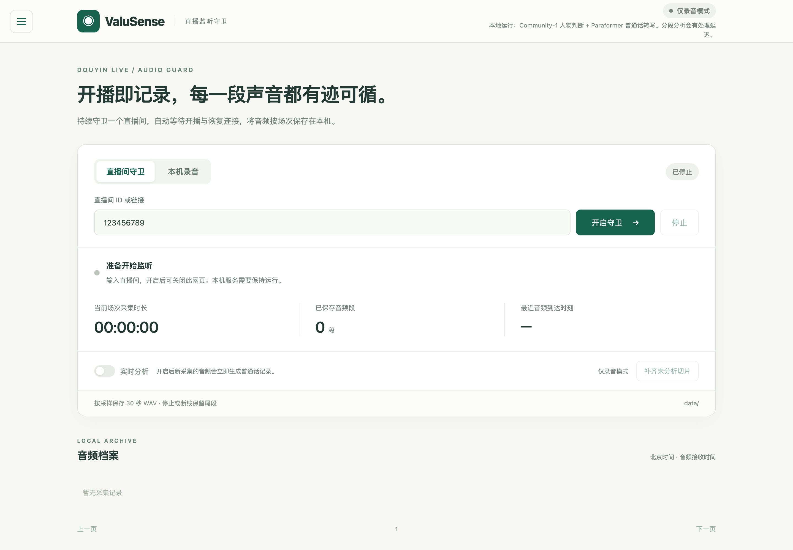

# ValuSense · 抖音直播监听、录音与普通话记录

在本机守护一个抖音直播间：未开播时等待，开播后自动按场次保存音频，下播或断线后继续等待下一场。默认**仅录音**，不需要 Token，也不会自动下载模型；登录网页后可以显式开启完整识别，生成带**音频接收时间、人物音色编号和讲话内容**的中文普通话记录。

网页、数据库、录音和分析模型全部在本机运行。界面叫 **ValuSense**，Python 包名与启动命令是 `douyin-live-sense`。



## 适合谁

适合想把某个中文普通话直播间完整留档、之后回听或检索的人：一次监听一个房间，音频按 16 kHz 单声道 WAV 保存在本机，约 115 MB/小时，历史记录不自动删除。它也支持不监听抖音、直接采集本机麦克风或系统声音。

不适合需要实时字幕、多人声源分离、跨场次人物身份识别，或想把它当作公网多用户服务的人——当前的边界见文末。

## 功能

| 功能 | 行为 |
| --- | --- |
| 直播守卫 | 未开播时等待，下播后等待下一场；断线自动重取播放地址并重连 |
| 本机录音 | 采集麦克风或浏览器标签页/屏幕音频，复用同一分析管道 |
| 音频档案 | 按场次保存 WAV，可展开任意切片回听、单段下载或整场 ZIP 下载 |
| 删除合集 | 硬删除整个合集及其音频与分析（采集中或分析中会被拒绝） |
| 整场分析 | 手动请求本场全部已保存切片，或在采集中开启实时分析持续追加 |
| 单片复核 | 单独分析或重新分析一个切片，保存独立版本，不覆盖整场结果 |
| 分析队列 | 每个分析请求一条进度记录，可展开查看切片状态与失败原因 |
| 人物编号 | 场次内按音色聚类，跨切片、重连与补分析保持一致；不同场次独立 |
| 文本记录 | 按时间排序，支持逐句回听及 TXT、Markdown、JSONL 下载 |
| 重启恢复 | 恢复守卫、实时开关与未完成任务，并修复未完成音频 |

## 快速开始

需要 **Python 3.11、[uv](https://docs.astral.sh/uv/) 和 FFmpeg**。macOS ARM64 与 Linux x86_64 支持完整识别；Linux ARM64 只支持录音。

```sh
git clone https://github.com/zhimeng123/douyinLiveSense.git
cd douyinLiveSense
./scripts/setup.sh    # 安装依赖、生成 .env、初始化管理员密码
./scripts/run.sh      # 启动服务
```

打开 <http://127.0.0.1:8787>，用初始化时打印的管理员密码登录（密码只在终端打印一次）。只想录音、不装分析依赖时用 `./scripts/setup.sh --record-only`。

## 日常使用

**直播间守卫**：输入房间 ID 或链接，点“开启守卫”。以下三种写法指向同一房间：

```text
123456789
https://live.douyin.com/123456789
https://live.douyin.com/?live_web_rid=123456789
```

开启后可以关闭网页，后台继续采集，但终端里的服务要保持运行。点网页“停止”会保存尾段并关闭守卫；终端 `Ctrl+C` 也会保存尾段并退出，同时保留守卫设置，下次启动自动恢复。

**本机录音**：在“本机录音”标签选择系统声音或麦克风。选系统声音时要在浏览器弹窗里勾选“分享音频”；macOS 通常只能分享浏览器提供的标签页/应用音频。录音期间需保持本标签页打开，关闭即停止，且不随服务重启恢复。本机录音与直播间守卫互斥。

**网站配置**：菜单 →“网站配置”。识别方式三选一：仅录音（默认）、纯本地模型识别、飞书秒记（暂未支持）。下方“录音时间配置”可改切片时长，范围 1 秒 – 4 小时，默认 30 秒，从下一段开始生效，录音不中断。任务进行中不能更改识别方式。

**分析**：选“纯本地模型识别”并准备好模型后，卡片底部的“实时分析”开关会持续处理新切片；停止采集后用“补齐未分析切片”处理整场。历史场次里点“分析本场全部切片”。单片可以点“分析”创建复核，或“重新分析”生成新版本。详细规则见 [识别与分析](docs/analysis.md)。

**档案与导出**：展开“音频档案”里的场次，可回听切片、下载单段、下载整场 ZIP（按主播名与时间命名）、下载 TXT / Markdown / JSONL，或删除整个合集。整场下载包含全部已生成发言，不受网页已加载条数限制。

**修改密码**：菜单 →“修改登录密码”，需要先输入当前密码。忘记密码时执行下面的命令重置，已登录的浏览器会全部失效：

```sh
uv run --env-file .env douyin-live-sense reset-password
```

## 数据与磁盘

```text
data/
  sense.sqlite3                  # 场次、切片、分析请求、人物和发言
  auth.json                      # 管理员密码哈希与会话密钥
  preferences.json               # 识别方式与切片时长
  audio/<room>/<session>/*.wav   # 音频，正在写入的为 .part
  models/                        # 模型、manifest.json 与 hf_token
  analysis/<session>/<run>/      # TXT / Markdown / JSONL 导出
  backups/  tmp/
```

音频约 115 MB/小时，分析模型约需 15 GB，历史音频不会自动清理。剩余空间不足 1 GB 时会保存尾段并停止采集。改用 `DLS_DATA_DIR` 会使用另一套数据库、模型和登录密码。

## 常用配置

配置文件是项目根目录的 `.env`（模板 [.env.example](.env.example)）。完整变量表见 [部署与配置](docs/deploy.md)。

| 变量 | 默认值 | 用途 |
| --- | --- | --- |
| `DOUYIN_COOKIE` | 空 | 抖音要求登录或触发风控时填入自己的 Cookie |
| `DLS_DATA_DIR` | `data/` | 数据、录音、模型与导出目录 |
| `DLS_HOST` | `127.0.0.1` | HTTP 监听地址 |
| `DLS_PORT` | `8787` | HTTP 监听端口 |
| `DLS_ALLOWED_HOSTS` | `127.0.0.1,localhost` | Host 允许列表，反代域名必须加入 |

## 部署

默认只监听本机。要上局域网或公网，交给 Caddy、Nginx、Cloudflare Tunnel、Tailscale 或 systemd，并配置 `DLS_ALLOWED_HOSTS` 与 `DLS_TRUST_PROXY`。应用只提供 HTTP，**不要把 8787 直接暴露到公网**。配置示例、systemd 单元和备份迁移见 [部署与配置](docs/deploy.md)。

## 常见问题

- **403 Host**：请求的域名不在 `DLS_ALLOWED_HOSTS`。
- **登录后循环回登录页**：HTTPS 反代要设置 `DLS_TRUST_PROXY=true` 并转发 `X-Forwarded-Proto: https`。
- **WebSocket 升级失败**：反代要支持 `/api/local/audio` 的 Upgrade；Nginx 需显式设置 `Upgrade` 与 `Connection` 头，并保留 Host 端口。
- **模型下载 401/403**：确认 Token 是只读 Token，并已在 Community-1 页面接受条款。

更多排查见 [常见问题与故障排查](docs/troubleshooting.md)。

## 文档

| 文档 | 内容 |
| --- | --- |
| [部署与配置](docs/deploy.md) | 平台支持、完整环境变量、反代/隧道/systemd、认证与备份 |
| [识别与分析](docs/analysis.md) | 三种识别方式、模型下载、整场/实时/单片复核、人物编号、文本范围 |
| [HTTP API](docs/api.md) | 全部接口、请求体、状态码与 WebSocket 协议 |
| [架构与实现](docs/architecture.md) | 模块职责、音频与时间、采集循环、数据目录、模型替换 |
| [常见问题](docs/troubleshooting.md) | 访问、采集、分析、音频与档案的排障 |
| [开发与验收](docs/development.md) | 测试命令、CI、真实验收工具与验证记录 |

## 开发与验证

```sh
uv run --locked --extra analysis pytest -q
uv run --locked --extra analysis ruff check src tests tools
uv run --locked --extra analysis ruff format --check src tests tools
uv run --locked --extra analysis python -m compileall -q src tests tools
node --check src/douyin_live_sense/static/app.js
```

自动化测试使用模拟直播源与可控分析适配器，不证明线上抖音可用或真实模型准确率。已执行的真实验证记录在 [VERIFICATION.md](VERIFICATION.md)，完整命令见 [开发与验收](docs/development.md)。

## 边界

- 一次监听一个房间，只支持中文普通话分析。
- 人物判断和文字可能出错；短发言、音乐、专业词汇及多人同时讲话会影响结果，尚无人工标注的 CER / DER 准确率评估。
- 分析速度与硬件和内容有关，可能积压；进度会如实显示。
- 电脑休眠或服务未运行时无法采集，缺口会保留。
- 不自动清理历史音频；抖音接口变化可能需要更新直播解析依赖或适配层。

## 许可证

本项目以 [MIT 许可证](LICENSE) 发布。第三方依赖与模型由各自许可方提供：分析模型由 `prepare-models` 从 Hugging Face 下载到本机，使用前请阅读模型页面的许可与条款，Community-1 需要在页面上接受条款。采集与使用他人直播内容还需遵守平台规则与当地法律。
